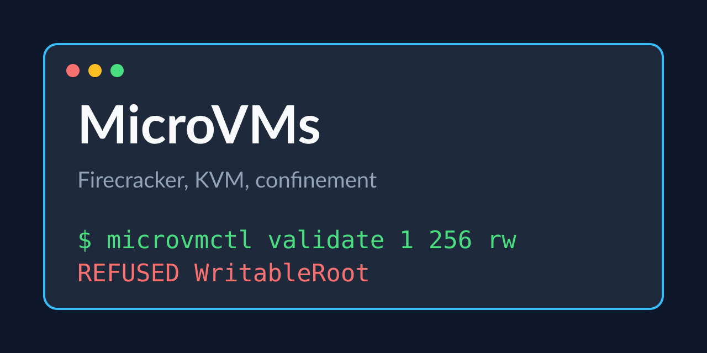

# MicroVMs

Firecracker configurations that stay confined, tested to 100%.

Tested Rust code for the fourth course of the Sandboxing specialization: a Firecracker configuration builder with confinement checks, run for real against KVM.

## Examples

| example | what it does |
|---|---|
| [`src`](src) | config, validate and args, plus a contract line |

## Prerequisites

- A Linux host with /dev/kvm access
- Rust 1.80 or newer

---

Generated — do not edit by hand. Edit `course.toml` and re-render.
